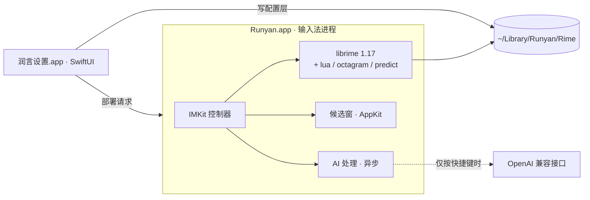

# 润言 · Runyan

[](https://github.com/a916791360/runyan-ime/actions/workflows/ci.yml)
[](LICENSE)

**打字时顺手把话说明白。** 一个 macOS 中文输入法：拼音输入在本机完成，AI 只在你按下快捷键的那一刻介入，把刚打出的那句话改得更得体——不打断思路，也不改变你的语气。

> 个人项目，作者 [@a916791360](https://github.com/a916791360)。拼音引擎基于开源项目 [librime](https://github.com/rime/librime)。
>
> 本项目是 [AIME](https://github.com/zoolapp/aime)（MIT）的二次开发：输入法外壳、设置面板、候选窗与 lua/词库生态继承自它，
> 润言在其上重做了品牌、外观、中英混排整形与 AI 动作流程。上游版权声明保留在 [LICENSE](LICENSE) 里，见[第三方声明](THIRD_PARTY_NOTICES.md)。

---

## 下载与安装

下载页：[Releases](https://github.com/a916791360/runyan-ime/releases/latest) → `Runyan-<版本>.zip`，解压后把 `Runyan.app` 拖进 `~/Library/Input Methods/`：

```bash
open ~/Library/Input\ Methods      # 没有这个文件夹就先建一个
```

然后**注销重登一次**，让系统扫到新的输入法；登录后在「系统设置 › 键盘 › 输入法」里点 ＋ 添加「润言」。

> **会被 Gatekeeper 拦一次，这是正常的。**
> 安装包用 Apple Development 证书签名，**没有做公证**（公证需要付费开发者账号）。
> 首次打开会提示「无法验证开发者」：去「系统设置 › 隐私与安全性」，
> 在底部点「仍要打开」，再确认一次即可。之后不再询问。
> 如果提示「已损坏」，是下载时带的隔离标记，执行一次：
> `xattr -dr com.apple.quarantine ~/Library/Input\ Methods/Runyan.app`

---

## 为什么做这个

输入法都在解决「打得快」，但办公场景里真正费时间的是**打完再改**：一句发给客户的话，先在输入框里打完，再删掉重写，再想想措辞。

润言把这个动作收进输入法本身：

- 你不用切到 AI 网页再粘回来，也不用打开任何对话框；
- 改的是**你刚打的那句话**，上下文就是当前的输入框；
- 结果作为候选出现，按空格采用、按 2 保留原文——**决定权始终在你手上**。

## 三档介入

| 档位 | 行为 | 适合 |
| --- | --- | --- |
| 直出 | 什么都不做，和普通输入法一样 | 写代码、聊天、快速记录 |
| 顺手 | 打完一句按快捷键，静默润色，改写结果排在候选第一位 | 回消息、写邮件、提需求 |
| 重写 | 选中整段再按快捷键，候选里给四种写法：润色 / 自然语言 / 正式 / 简洁 | 写周报、改文案、润色文档 |

## 功能

- **AI 润色**：对选中文字、刚打的字或正在选的候选执行润色、翻译，或用自己写的提示词（如「改成粤语」）做自定义处理；结果以候选列表呈现，回车替换。
- **自备模型**：不内置 Key、不做代理。填任意 OpenAI 兼容接口（`baseURL` + `apiKey` + `model`）即可；也可用 Apple 端侧模型（取决于设备与地区）。未授权时不会外发任何文字。
- **快捷菜单**：打字时长按 ⌥ 再按空格进入 AI 处理，1–4 切常用语、符号、高频词、表情，全程不离开键盘。
- **输入图层**（可选）：打出的字先停在光标处，回车上屏，便于整段润色后再发送。
- **表情板**：1906 个离线 emoji，9 大类，数字切分类、字母直选。
- **可视化设置**：候选数量、中英切换、模糊音、简拼纠错、快捷键、简繁输出、按应用默认中英文等 80 余项，覆盖常用 RIME 配置。
- **外观**：配色画廊与实时预览、字体字号、横排 / 竖排、圆角与间距，对比度不足时提示。
- **词库**：订阅任意 RIME 兼容词表；雾凇、万象、白霜等方案一键安装，冲突先提示；版本与 SHA-256 校验后使用。
- **常用语与短语**：分类管理手机号、邮箱、地址；表格编辑自定义短语。
- **输入统计**（可选，仅本机）：每日字数、时段与应用分布、高频词。
- **备份与迁移**：一键导出/恢复本地备份；可从鼠须管**只读**导入已有配置，不改动原目录。
- **命令行**：`runyan deploy / bench / doctor / import-squirrel / get / set / sync`，便于脚本化与回归。

## 架构



- **输入法外壳**：纯 InputMethodKit，`LSUIElement` 后台进程，由 `imklaunchagent` 拉起；不用手写 Xcode 工程，`xcodegen` 从 `project.yml` 生成。
- **拼音引擎**：librime 1.17 静态链接，加载 lua / octagram / predict 三个插件；默认方案雾凇拼音。
- **模块划分**（SwiftPM）：`RunyanCore`（配置合成、路径、词库、AI 客户端）、`RunyanPanel`（候选窗渲染）、`RunyanAI`（Provider 抽象与提示词）、`RimeKit`（librime 桥接）、`runyan`（CLI）。
- **设置 App 不链接 librime**：只读写文件，通过分布式通知请求输入法重新部署。配置由三层合成：内置默认 → 手写补丁 → 界面修改。

详见 [架构说明](docs/architecture.md) 与 [架构决策记录](docs/decisions/)。

## 构建

需要 macOS 26+、Xcode 26+、[XcodeGen](https://github.com/yonaskolb/XcodeGen)（`brew install xcodegen`）。

```bash
git clone https://github.com/a916791360/runyan-ime.git && cd runyan-ime
bash scripts/install-dev.sh
```

脚本会下载并校验固定版本的 librime 与雾凇拼音，构建输入法、设置 App 与命令行工具，安装到 `~/Library/Input Methods/Runyan.app` 并注册输入源。

装完在 **系统设置 › 键盘 › 输入法 › 编辑…** 点 **+**，在「简体中文」里添加「润言」。**首次安装需要注销重新登录一次**——系统只在登录时扫描 `~/Library/Input Methods/`。

单独构建各层：

```bash
bash scripts/fetch-librime.sh && bash scripts/fetch-dicts.sh
swift build --package-path Packages/RunyanKit && bash scripts/stage-plugins.sh
swift test --package-path Packages/RunyanKit
xcodegen generate && open Runyan.xcodeproj
```

## 隐私

输入、候选、词频全部留在本机，不写输入日志，不内置遥测或崩溃上报 SDK。

AI 是**逐次授权**的：只有你按快捷键触发时，那一段文字才会发给所选模型；更换接口域名后授权会自动失效，需要重新确认。详见 [隐私说明](docs/privacy.md)。

## 目录

```
Apps/Runyan/            输入法进程（IMKit 控制器、引擎、AI 动作）
Apps/RunyanSettings/    设置 App（SwiftUI）
Packages/RunyanKit/     SwiftPM 模块：Core / Panel / AI / RimeKit / CLI
SharedSupport/          随包分发的默认配置、符号表、表情数据
scripts/                构建、安装、诊断与资源生成
docs/                   架构、隐私、配置参考、排障
```

## 路线图

- [x] librime 前端、候选窗、命令行、开发安装
- [x] 可视化设置、外观预览、常用语与自定义短语
- [x] 词库订阅与方案包管理（固定版本 + SHA-256）
- [x] 快捷菜单、AI 润色 / 翻译 / 自定义动作、输入图层
- [x] 输入统计、首次引导、本地备份与恢复
- [ ] 场景感知（按 App 自动选语气）
- [ ] 风格卡片：从你改过的句子里学措辞偏好，不微调模型
- [ ] 候选窗翻页指示与竖排优化

## 许可

本仓库源码采用 [MIT](LICENSE) 许可。安装包另含 GPL-3.0 组件（`librime-octagram` 插件、雾凇拼音方案与词表），因此**分发包作为整体按 GPL-3.0 条款分发**，源码本身仍是 MIT。

librime、rime-ice、OpenCC、Yams 等第三方组件的许可与出处见 [THIRD_PARTY_NOTICES.md](THIRD_PARTY_NOTICES.md)。
